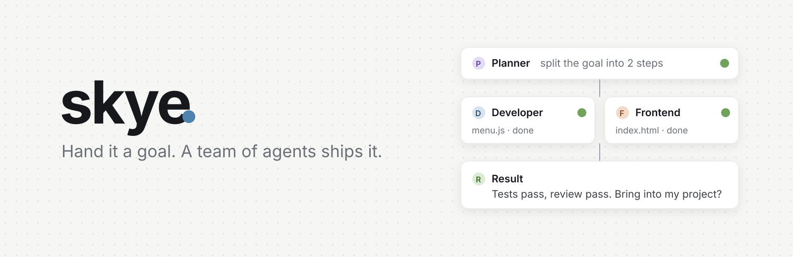
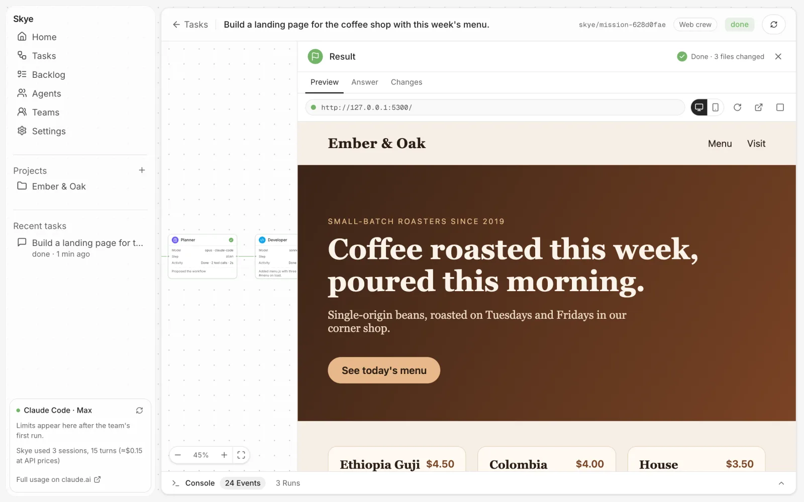
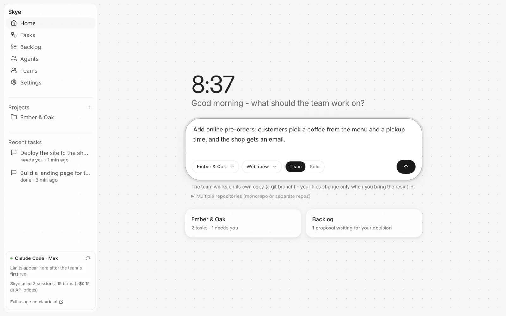
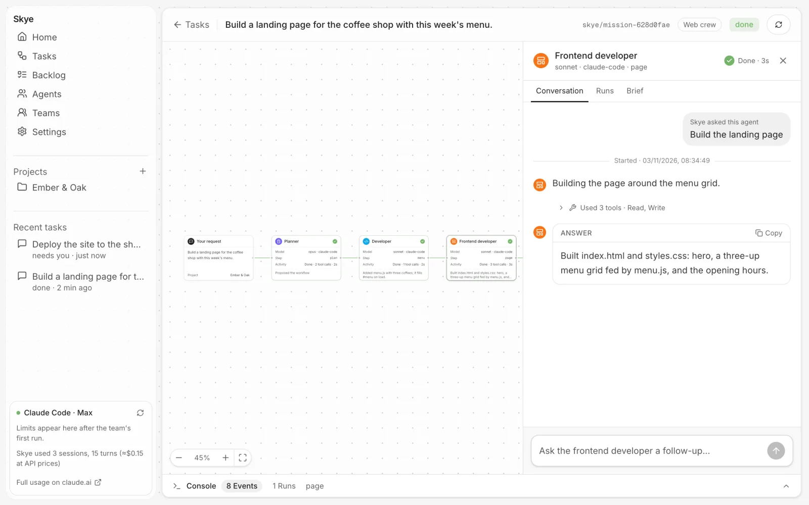
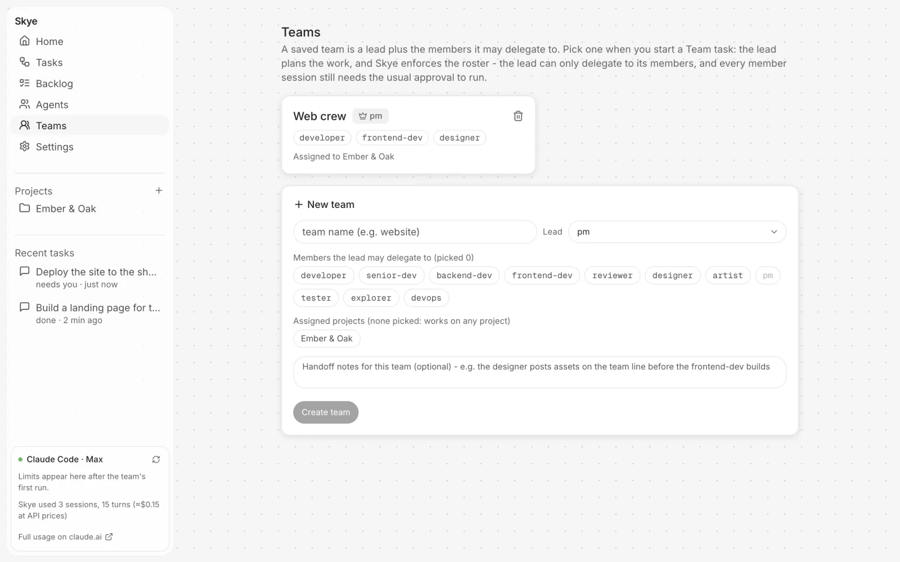

<h1 align="center">skye</h1>

<p align="center">
  <strong>An engineering team of coding agents, on your machine.</strong><br />
  Hand Skye a goal. A team of agents plans it, builds it, reviews it and checks it, and stops to ask you before anything that needs your say-so.
</p>

<p align="center">
  <a href="#get-started"><strong>Get started</strong></a> ·
  <a href="#how-a-task-runs">How it works</a> ·
  <a href="#workers">Workers</a> ·
  <a href="#questions">Questions</a> ·
  <a href="#honest-status">Status</a>
</p>

<p align="center">
  <a href="LICENSE"></a>
  
  
  
</p>

<p align="center">
  Built at <a href="https://github.com/sankhya-ai">Sankhya AI Labs</a>. Free and open source.
</p>

---



One coding agent is great at one task. Real goals need a few: someone to plan, someone to build the backend, someone for the screen, someone to check the work. Skye is that team. It runs on the coding agents you already use, keeps every step on the record, and never lets work outside your rules run without asking.

Skye does not ship a model, resell tokens or download an agent for you. Tokens are spent only inside the workers, on your own subscription.

## What it does

| | |
|---|---|
| **A team, not one agent** | Built-in roles (developer, frontend, backend, reviewer, designer, tester, devops, PM and more), each with its own instructions and tools. Add your own; workers can propose new specialists, which wait until you promote them. |
| **Saved teams with a lead** | Save a lead and the members it may delegate to. The lead plans; Skye enforces the roster, so it can only hand work to its members. Off-roster work pauses the task for you. |
| **Workflows that grow as they run** | Steps hand off to each other, run in parallel when they can, and may propose follow-up steps. Every transition is journaled, so a crash resumes instead of restarting. |
| **You stay in charge** | A policy decides what runs unattended. Everything else waits for a one-time approval tied to the exact step. New ideas land in a backlog for you to approve. |
| **Review before delivery** | Your test command, a reviewer that must say pass, and an optional journey check you own all gate the result. |
| **See the result, then bring it in** | Every task works on its own git branch. Preview the site it built, read the answer, check the changed files, then **Bring into my project**. |
| **Live control** | Watch each agent's conversation, send a follow-up mid-run, stop a run, or hand a failed step to the team lead. |
| **A model per agent** | Opus for the planner and reviewer, Sonnet for developers, Haiku for exploring, or whatever you pick. |

<table>
<tr>
<td width="50%"><p align="center"><sub>Describe the goal, pick a team</sub></p></td>
<td width="50%"><p align="center"><sub>Open any agent's conversation</sub></p></td>
</tr>
<tr>
<td width="50%"><p align="center"><sub>Nothing outside your policy runs without you</sub></p></td>
<td width="50%"><p align="center"><sub>Saved teams with a lead</sub></p></td>
</tr>
</table>

<p align="center"><sub>Screens from a scripted demo task: no model calls.</sub></p>

## Get started

You need Python 3.10+, git and [Claude Code](https://claude.com/claude-code) or [Codex](https://github.com/openai/codex), logged in. You don't need Node: the UI ships prebuilt.

```sh
git clone https://github.com/sankhya-ai/Skye.git && cd Skye
./install        # one time: sets up .venv/ and puts `skye` on your PATH
skye run         # starts Skye and opens it in your browser
skye stop        # when you're done
```

Then, in the browser:

1. **Add your project folder.** If it isn't a git repository yet, Skye offers to make it one.
2. **Describe the goal** and choose how to staff it: **Solo** (one session, fewest tokens), **Team** (a planner sizes the team), or one of your **saved teams**.
3. **Watch it run**, preview the result, then press **Bring into my project**.

**Your files stay safe.** Each task works in its own git worktree on branch `skye/<task-id>`. Bringing it in is a plain `git merge` into your current branch: git won't overwrite your uncommitted edits, a conflict is aborted and explained, and caches like `node_modules` are never brought in.

<details>
<summary>What the first run sets up</summary>

In `.skye/policy.json`, editable in **Settings**:

- Claude Code and Codex steps run without a per-step approval click. Starting a task is your go-ahead.
- Tasks get worktrees, and up to 2 steps run in parallel.
- No test command is set. Add one (e.g. `pytest -q`) and every step must pass it.
- Workers get exactly their role's tools and no MCP tools. Your interactive Claude Code hooks and MCP servers don't run inside workers.
- Model defaults: planner and reviewer on Opus; developers, tester, designer and devops on Sonnet; explorer on Haiku.

The sidebar shows your Claude plan, your 5-hour and weekly limits and what Skye used, read from `claude auth status` and the rate-limit reports Claude Code sends during runs. Checking it costs no tokens.

</details>

## How a task runs

```
goal -> plan -> policy check -> workers -> gates -> result -> bring into my project
```

1. **Plan.** Solo skips planning. Otherwise a planner (or your team's lead) proposes the smallest workflow, and Skye validates every step.
2. **Policy check.** A step outside your policy waits for a one-time approval of exactly that step.
3. **Workers.** Each step is a session of your own Claude Code, Codex or Root, in the task's worktree, with its role's tools.
4. **Gates.** The output contract, your test command, and a reviewer that must say pass. Delivery can also require replaying a journey check you own.
5. **Result.** Preview the site, read the answer, check the changes, and bring it in.

**When a step fails**, the attempt stays on the record and the task stops instead of pretending. Follow up with that agent, reset the step, or **hand it to the lead**: the lead answers through the same validated path (roster, policy and gates still apply), once per handoff. Every attempt is kept as a run, so you see the whole history, not just the last state.

No LLM sits in the coordination path. Dispatch, policy, approvals and gates are plain code.

## Workers

| Worker | How Skye drives it |
| --- | --- |
| **Claude Code** | Your local install, through its CLI with streaming JSON. Your login, your subscription. |
| **Codex** | Your local install, through `codex app-server` (JSON-RPC over stdio), falling back to `codex exec` if the app-server can't start. Read-only roles run in Codex's `read-only` sandbox, writing roles in `workspace-write`, and Skye declines every escalation request. |
| **Root** (vendored in `root/`) | An open coding agent with scoped jobs that park and resume. Skye uses its owner HTTP API and reattaches to interrupted jobs. Optional. |

**Chamber** (vendored in `chamber/`) can carry sealed team messages between agents when you configure a line. It's optional.

## Questions

**Do I need an API key or a new subscription?** No. Skye drives the Claude Code or Codex you're already logged into.

**Can I use Codex instead of Claude Code?** Yes. Pick Codex as the worker when you start a task, or per role. With both installed, Claude Code is the default.

**Will it change my code without asking?** Agents work on their own branch in a separate worktree. Your project changes only when you press **Bring into my project**.

**What can an agent do on my machine?** What its role's tool list allows. Those lists are guards your coding agent enforces, not an OS sandbox: a role with Bash can do what Bash can.

**Does anything leave my machine?** The UI is served on `127.0.0.1` only and needs a local token. Your coding agent talks to its own provider, as it always does.

## Honest status

Skye is a working local core, not a finished product.

- **Verified:** the test suite (402 passed at the last full run), real end-to-end jobs against the vendored Root with its scripted model, and browser checks of the UI.
- **Verified with real Claude Code:** a Solo and a Team task on a small Python project: both edited files, passed the test gate and were brought back in. Each took 10-20 seconds and a few cents at API prices.
- **Not yet verified:** real Codex runs (the adapter is tested against a protocol fake), large multi-step tasks with real models, and planning quality on real apps.
- **Not built:** the hosted edition and multi-machine teams. See [docs/editions.md](docs/editions.md).

Every enforced control and its known limits are in [docs/technical-status.md](docs/technical-status.md).

<details>
<summary>Command line</summary>

The UI does everything, but there is a CLI for scripting:

```sh
skye check examples/job.json            # validate a contract
skye run examples/job.json              # one contract: policy check -> worker -> gates
skye approve examples/job.json          # one-time approval of exactly that contract
skye mission run examples/flow.json     # run or resume a workflow you wrote
skye mission status examples/flow.json  # show its progress
skye mission handoff <mission.json> --step <id>   # hand a failed step to the lead
```

A contract looks like this:

```json
{"goal": "add the health endpoint", "repo": "/path/to/repo", "role": "developer",
 "adapter": "claude-code", "gates": ["tests", "review"],
 "brief": "Small self-contained brief for the worker."}
```

Saved teams live in `skye.teams.json` (or `SKYE_TEAMS`). A task snapshots its team's roster when it starts, so editing the team later never retargets work already running.

For the `root` adapter, start the vendored Root server; Skye finds it at `SKYE_ROOT_URL` (default `http://127.0.0.1:8788`). To publish events to a Chamber line, set `SKYE_LINE_INVITE` and `SKYE_LINE_TO`.

</details>

## License

Apache 2.0. See [LICENSE](LICENSE).

Vendored and adapted code keeps its own notices: `chamber/LICENSE` and `chamber/NOTICE`, `root/runtime/LICENSE` and `root/runtime/NOTICE`, and `skye/ui/NOTICE` for UI components adapted from Apache-2.0 projects. See `VENDORING.md` for sources and versions.
