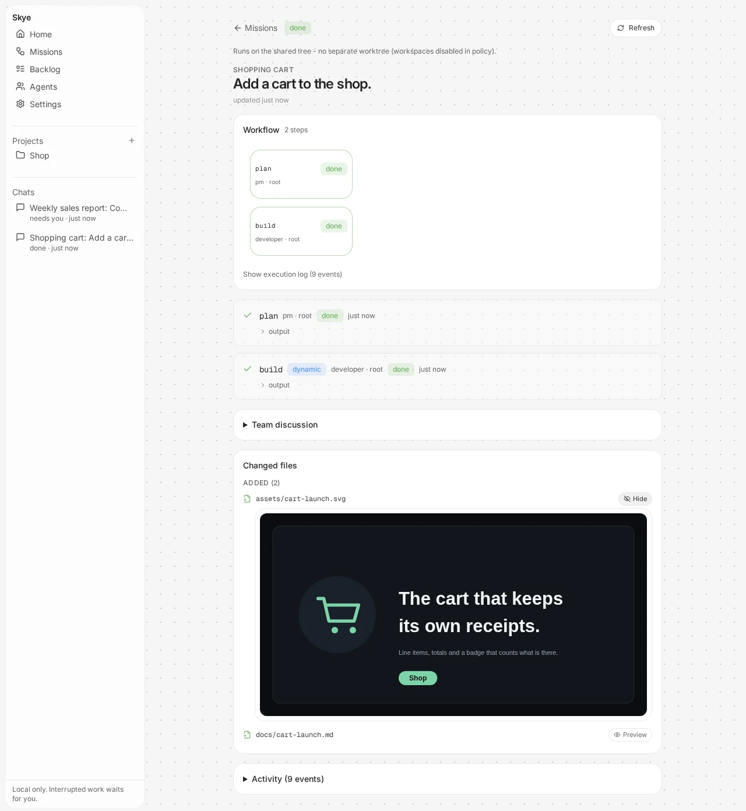
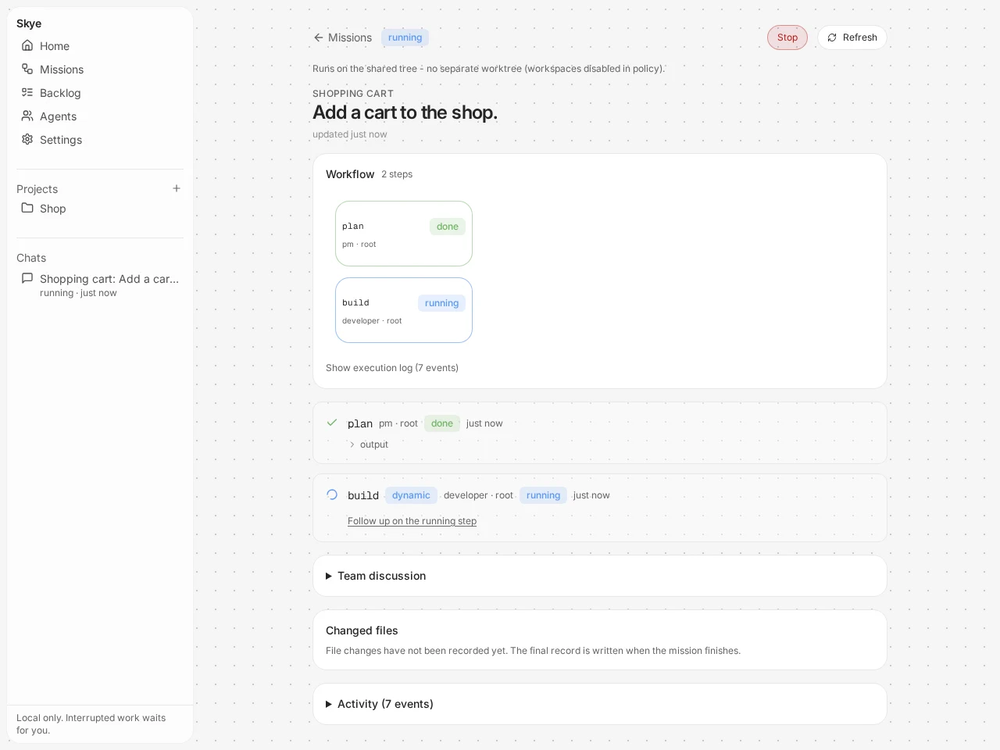
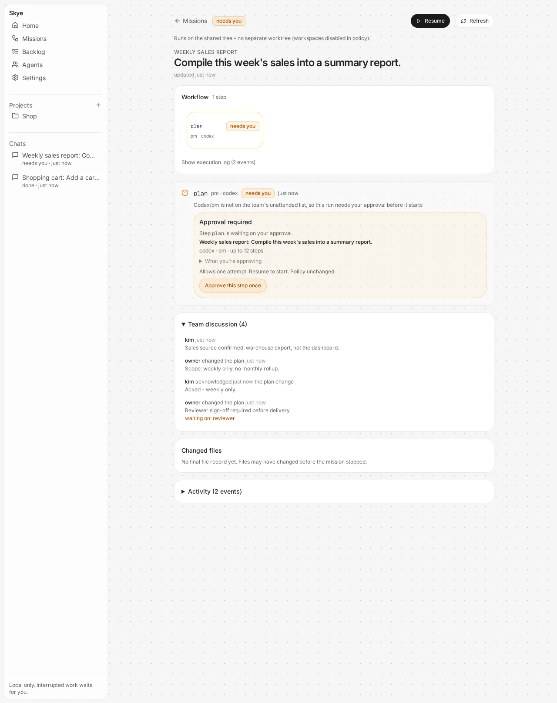
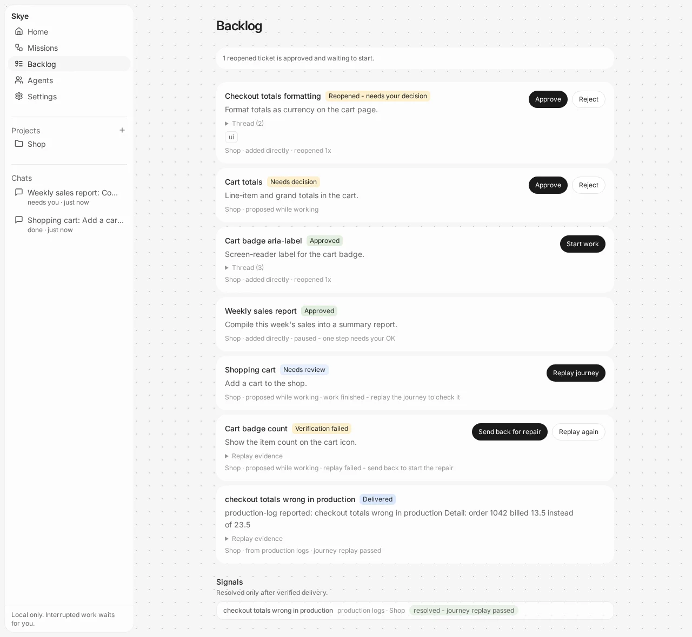
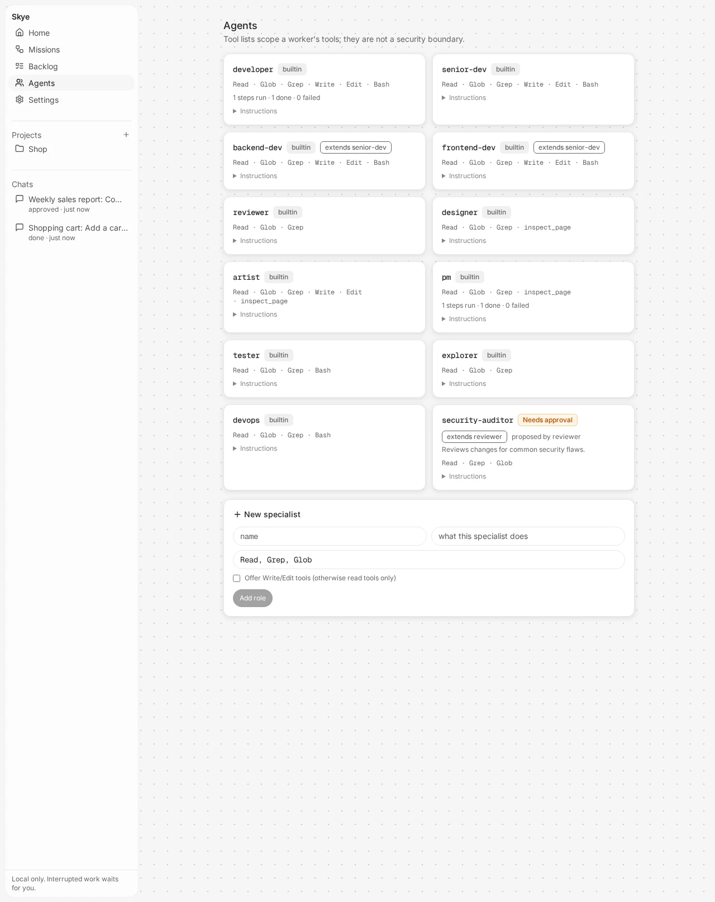

# Skye

**An autonomous engineering team in a box.** Hand Skye a goal. A team of coding agents plans it,
builds it, reviews it and checks it, and stops to ask you before anything that needs your say-so.

Skye runs on your machine and drives the coding agents you already use. It does not ship a model,
resell tokens or download an agent for you.

[Quick start](#quick-start) | [How it works](#how-it-works) | [Workers](#workers) | [Screens](#screens) | [Honest status](#honest-status) | [License](#license)

<p align="center">
  
</p>

<p align="center">
  <sub><em>A demo mission in the local UI - scripted, no model calls.</em></sub>
</p>

---

## What Skye gives you

- **A team, not a single agent.** Standard roles (developer, senior dev, backend, frontend,
  reviewer, designer, artist, PM, tester, explorer, devops), each with its own instructions and an
  explicit tool catalogue. You can add or refine roles, and workers can propose new specialists,
  which stay inactive until you promote them.
- **Saved teams with a lead.** Create a team once - a lead plus the members it may delegate to,
  optionally tied to projects - then pick it when you start a Team task. The lead plans the work
  and Skye enforces the roster: the lead can only delegate to its members, and every member
  session still passes the usual policy check or your one-time approval before it runs.
- **Workflows that grow as they run.** A mission is a persisted workflow of steps with handoffs and
  conditions. A finished step can propose follow-up steps. Independent steps run in parallel, and
  every transition is journaled so a crash resumes instead of restarting.
- **You stay in charge.** An owner policy decides what runs unattended. Everything else waits for a
  one-time approval tied to the exact contract. Ideas for new work land in a backlog and need your
  approval before they start.
- **Review before delivery.** A second worker reviews the first and must return an explicit pass.
  A review can send work back with feedback for a bounded number of rounds.
- **Live control of running work.** Watch output and progress, send follow-ups to a running agent
  with honest delivery status, continue a recorded session or start a step fresh, and stop a run
  with confirmed-stop and uncertain states kept separate.
- **Tickets that remember.** Backlog items are tickets with labels and a permanent thread. A bug
  found on delivered work reopens the same ticket with its evidence.
- **A local UI.** `skye run` opens missions, run traces, the journal and approvals in your
  browser (served on 127.0.0.1 only). It also shows your Claude Code plan and usage limits.
- **A model per agent.** Pick Opus, Sonnet or Haiku for each role on the Agents screen. For
  example: planner and reviewer on Opus, developers on Sonnet.
- **No LLM in the coordination path.** Dispatch, policy, approvals and gates are plain code. Tokens
  are spent only inside the workers, on your own subscriptions or keys.

## How it works

```
goal -> contract -> policy check -> worker -> gates -> delivery

policy check: outside the policy? needs-owner, approve once
worker:       Root, Claude Code or Codex
gates:        output contract, tests, reviewer verdict, journey check
```

1. You write a **contract**: goal, repo, role, adapter, gates and a small brief.
2. Skye checks it against your **policy**. Anything outside the policy comes back `needs-owner`.
3. A **worker** does the job in your repo through its adapter.
4. **Gates** decide whether the result counts: a contract check on the output, your test command,
   and a reviewer who must say pass. Delivery can also require replaying a journey check you own.
5. Lifecycle events go to a local `events.jsonl`, or to a Chamber line if you configure one.

## Solo, ad-hoc team or saved team

Every goal starts one of three ways from the Home composer:

- **Solo** - one worker session does the goal directly, like driving the CLI yourself. Fewest
  tokens, no planning session.
- **Ad-hoc team** - a planning session reads the goal and proposes the smallest workflow, which
  the engine validates and dispatches step by step.
- **A saved team** - you pick a team you created on the Teams screen. Its lead runs the planning
  session and may only delegate to the members you saved into the roster: a proposed step for any
  other role is rejected and journaled, and if nothing in the roster ran, the task pauses for you
  instead of pretending it is done. Saving a team runs nothing and grants nothing - membership
  constrains the lead, it never widens what may run. Handoffs between members are settled
  outcomes plus the async team line; nobody pushes into a member's running session.

Teams live in `skye.teams.json` (owner-managed, like the policy and roles files). A team's
missions snapshot their roster at creation, so editing the team later never retargets work
already defined.

## Workers

| Worker | What it is |
| --- | --- |
| **Root** (vendored in `root/`) | An open coding agent with dynamic tools, scoped jobs and missions that park and resume. Best integrated: Skye uses its real owner HTTP API and reattaches to interrupted jobs. Optional. |
| **Claude Code** | Your local install, driven through its CLI. Your login, your subscription. |
| **Codex** | Your local install, driven through `codex app-server` (JSON-RPC over stdio), with a one-shot `codex exec` fallback when the app-server is unusable before a turn starts. Your login, your subscription. |

**Chamber** (vendored in `chamber/`) is the built-in coordination layer. Skye uses its relay to
carry sealed team messages when you configure a line, and it stays optional for the engine, the
journal, approvals and the UI.

## Screens

The local UI (`skye run`), pictured on a scripted demo mission - no model calls, no cost.

**Watch a mission run.** Steps report live, and you can follow up on the running step or stop it.

<p align="center">
  
</p>

**Nothing outside your policy runs without you.** An out-of-policy step waits for a one-time approval tied to the exact contract.

<p align="center">
  
</p>

**Tickets remember.** Proposals, approvals, repairs and verified deliveries keep their thread and their evidence.

<p align="center">
  
</p>

**A team of roles that workers can extend.** Proposed specialists stay inactive until you promote them.

<p align="center">
  
</p>

## Quick start

You need Python 3.10+, git and [Claude Code](https://claude.com/claude-code), logged in (run
`claude` once). You don't need Node: the UI ships prebuilt.

```sh
git clone https://github.com/sankhya-ai/Skye.git && cd Skye
./install        # one time: sets up .venv/ and puts `skye` on your PATH
skye run         # every time, from any folder: starts Skye and opens it in your browser
skye stop        # when you're done
```

In the browser:

1. **Choose your project folder** (a native folder picker). If the folder isn't a git
   repository yet, Skye offers to make it one.
2. **Describe the goal** and pick how to staff it:
   - **Team**: a one-turn planning session sizes the team. Usually that's a single developer.
     Larger goals get a few parallel specialists.
   - **Solo**: one developer session with no planning. This uses the fewest tokens.
3. **Watch it run**, send follow-ups to a running step, then press **Bring into my project**.

**Your files stay safe.** Each mission works in its own git worktree on branch
`skye/<mission-id>`. "Bring into my project" is a plain `git merge` into your current branch.
Git won't overwrite your own uncommitted edits, a conflict is aborted and explained, and caches
such as `__pycache__` and `node_modules` are never brought in.

**Models per agent.** On the **Agents** screen every role has a model picker. The defaults are:
- planner (`pm`) and reviewer: Opus
- developers, tester, designer, devops: Sonnet
- explorer: Haiku

Each step on a mission page shows which model it ran on.

**Claude usage is in the sidebar.** The card shows your plan, the 5-hour and weekly limits (how
much is left and when they reset) and what Skye itself used. The data comes from `claude auth
status` and from the rate-limit reports Claude Code sends during runs, so checking it costs no
tokens. The numbers are as of the last run.

**What the first run sets up** (in `.skye/policy.json`, editable in Settings):
- Claude Code steps run without a per-step approval click. Starting a mission is your go-ahead.
- Missions get worktrees, and up to 2 steps run in parallel.
- No test command is set. Add one (e.g. `pytest -q`) and every step must pass it. Without one,
  the default tests gate is recorded as *skipped*.
- Workers get exactly their role's tools (`--allowedTools` plus `--permission-mode dontAsk`)
  and no MCP tools. Your interactive Claude Code hooks and MCP servers don't run inside workers.

### Command line (advanced)

```sh
skye check examples/job.json            # validate a contract
skye run examples/job.json              # one contract: policy check -> worker -> gates
skye approve examples/job.json          # one-time approval of exactly that contract
skye mission run examples/flow.json     # run or resume a workflow you wrote yourself
skye mission status examples/flow.json  # show mission progress
```

`examples/job.json` is a contract (set `repo` to a real path first). `examples/flow.json` is a
two-step workflow you author yourself (PM scopes, developer builds). A contract looks like this:

```json
{"goal": "add the health endpoint", "repo": "/path/to/repo", "role": "developer",
 "adapter": "claude-code", "gates": ["tests", "review"],
 "brief": "Small self-contained brief for the worker."}
```

For the `root` adapter, start the vendored Root server locally. Skye finds it with `SKYE_ROOT_URL`
(default `http://127.0.0.1:8788`) and authenticates with `SKYE_ROOT_TOKEN` or Root's local token
file. To publish events to a Chamber line, set `SKYE_LINE_INVITE` and `SKYE_LINE_TO`.

## Honest status

Skye is a working local core, not a finished product.

- **Verified:** the Skye test suite (363 passed, 1 skipped at the last full run), real end-to-end
  jobs against the vendored Root using its scripted model, and browser checks of the UI.
- **Verified with real Claude Code:** a Solo mission and a Team mission (planner, then one
  developer) on a small Python project. Both edited files, passed the test gate and were merged
  back with "Bring into my project". Each took 10-20 seconds and a few cents at API prices.
- **Not yet verified:** real Codex runs, large multi-step missions with real models, and design
  or planning quality on real apps.
- **Not a sandbox:** tool catalogues and write claims are cooperative guards, not OS security
  boundaries. A role whose catalogue includes Bash can do anything Bash can.
- **Not built:** the hosted edition and multi-machine teams. See `docs/editions.md`.

The detailed engineering notes, including every enforced control and its known limits, are in
`docs/technical-status.md`.

## License

Skye is released under the **Apache License 2.0**. See [LICENSE](LICENSE).

Vendored and adapted code keeps its own notices: `chamber/LICENSE` and `chamber/NOTICE`,
`root/runtime/LICENSE` and `root/runtime/NOTICE`, and `skye/ui/NOTICE` for the UI components
adapted from Apache-2.0 projects. See `VENDORING.md` for sources and versions.
