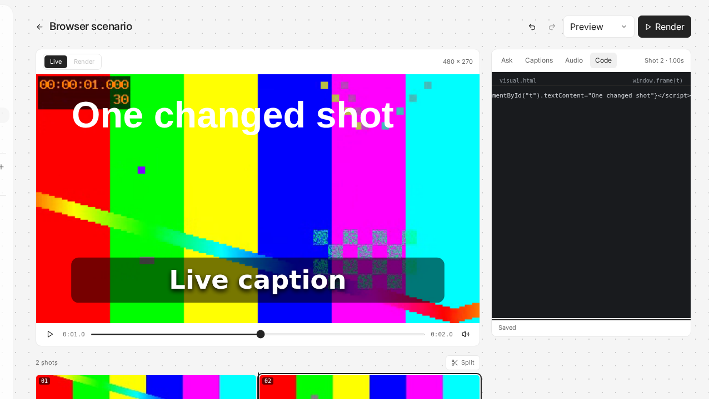

# Code-backed shots

Open **Video** in Skye's browser UI. There is no desktop app. Skye's local backend handles import and export; this is not a browser-only WASM editor.

Import a video, pick a shot, and change it by asking your coding agent or editing captions, audio or code. See changes live, then render. The original remains unchanged. Footage remains pixels, not recovered objects, layers or camera geometry.

## Install the optional runtime

Skye's base Python install still uses the standard library only. For video:

```sh
python -m pip install -e '.[media]'
# Install an FFmpeg / ffprobe build with libvpx-vp9 and libopus on PATH.
# See LICENSES.md before distributing a binary or installer.
cd skye/media
npm ci
npx playwright install chromium
cd ../..
skye video doctor
skye run
```

Use Node 20 or later. The renderer uses a separate, empty Chromium profile with its sandbox enabled. It does not use your interactive browser, cookies or logins. If Chromium's sandbox cannot start, rendering fails; Skye does not disable it. `SKYE_CHROMIUM` may point to an installed compatible Chromium executable. Installing the optional runtime needs downloads; editing and rendering make no network or model calls.

The backend must run on the machine holding the media and coding-agent logins. The browser can be its UI. Do not expose Skye directly to the internet without an authenticated front door. Existing API-token and same-origin protections apply to all media routes, uploads and previews.

## Workflow

1. **Drop a video.** MP4, MOV, WebM, AVI or MPEG, up to 10 minutes and 512 MB. Upload shows progress. HDR imports fail explicitly rather than silently rendering the wrong colors.
2. Skye keeps the original and makes an SDR, square-pixel, 30 fps VP9/Opus mezzanine, up to 1920 x 1080. **Find cuts** uses local PySceneDetect AdaptiveDetector. It finds visual changes, not speech or meaning, so a talking head may remain one shot.
3. **Shots** sit in a filmstrip under the player. Click one to jump to it. **Split** (or `S`) cuts at the playhead. Click the seam between two shots to join them. Splitting and joining keep code, captions and audio; a join says what it dropped. Everything can be undone.
4. **Live** preview shows your graphics and captions over the footage as you type, and shows runtime errors in the Code tab. It is a sandboxed iframe with no network and uses the same harness file as the renderer. **Render** shows the exported video.
5. The inspector has **Ask**, **Captions**, **Audio** and **Code**. Captions and audio are forms. Edits autosave. A burst of typing is one Undo step.
6. **Render** (top right) builds a 640px preview or a full-quality, source-sized export, then joins cached pictures and does one continuous audio encode. Exports are WebM (VP9/Opus), not MP4. Changing one shot re-renders only that shot's picture. Audio-only changes do not touch picture caches.

Keys: `Space` play, `Left`/`Right` step a frame (`Shift` for ten), `S` split, `[` `]` previous and next shot, `Cmd/Ctrl+Z` undo, `Shift+Cmd/Ctrl+Z` redo.

Only one heavy video job runs at a time. Output chunks are encoded serially with two FFmpeg threads. Graphics that do not read the footage canvas are drawn as a transparent layer and composited by FFmpeg, which is much faster than drawing every footage frame in the page. Code that reads or styles `#source` takes the slower path.

Measured on a 2-vCPU Linux box (not an M1): 640px preview about 22 fps, 720p final about 15 fps, 1080p final about 13 fps for overlay-only shots. Shots that read the footage canvas are several times slower. Do not take these as M1 numbers.

## Ask your coding agent

Open **Ask**, pick Claude Code or Codex, type what should change and press Enter. One step: Skye prepares a disposable proposal for the selected shot, records your Send as the approval for exactly that job, runs your own installed and logged-in agent through the existing dispatcher, imports only the three shot files, then renders just that shot. The result appears live and as an entry you can undo. If the agent is not installed, the panel says so. The built-in `artist` role can read and write files, but has no Bash. MCP remains blocked for Claude Code. Owner role/tool overrides and the concurrency policy still apply. Your provider allowance is used when you press Send.

The agent is told the shot's frame count and canvas size, gets a reference frame, and is asked to prefer overlays over touching the footage canvas. The manual route stays available:

```sh
skye video --state-dir /path/to/.skye prepare PROJECT_ID shot-0002 --adapter claude-code --goal 'Make the title shorter'
skye approve /path/to/PROPOSAL_ID.job.json
skye run /path/to/PROPOSAL_ID.job.json
skye video --state-dir /path/to/.skye apply PROJECT_ID PROPOSAL_ID
skye video --state-dir /path/to/.skye render PROJECT_ID
```

The import gate refuses extra files, symlinks, changed metadata, stale revisions, captions crossing a cut and audio settings outside the shot. This is an application-level boundary, not an OS filesystem jail for Claude/Codex. Run untrusted workers in an appropriate system sandbox if you need that guarantee.

## Shot code

```html
<style>
#label { position:absolute; left:6%; top:8%; color:white; font:600 42px system-ui; }
</style>
<div id="label"></div>
<script>
window.frame = (t) => {
  const label = document.getElementById('label');
  label.textContent = 'One small change.';
  label.style.opacity = String(Math.min(1, t * 3));
  document.getElementById('source').style.filter = 'saturate(0.85)';
};
</script>
```

`source` is the original footage frame on a canvas. You can crop, transform, mask, cover or filter it with CSS, or draw over it. Code must set a complete state from `t`, not accumulate mutations across frames. The logical canvas stays source-sized in both preview and final, so positioning scales with the output. Browser CSS animations/transitions and timers are disabled. The renderer fixes random values and supplies a local clock. This helps repeatable rendering, but is not a proof of determinism for arbitrary JavaScript or different system fonts/browser versions.

Shot pages have no audio, external URLs, local-file URLs, npm imports or network access. Use inline SVG, CSS, canvas and data-URI assets. This initial implementation does not load external JS libraries, even ones you installed elsewhere. HTML runs only in the isolated rendering browser, never inline in the Skye UI or in Node. Runtime code errors fail the render instead of exporting blank frames as success.

Captions use local, end-exclusive integer frames:

```json
[{"start": 0, "end": 30, "text": "One second, only in this shot."}]
```

Audio settings affect only the source audio slice owned by this shot:

```json
{"gain": 1, "mute": false, "fade_frames": 0}
```

Gain is 0 to 4. A fade cannot exceed half the shot. At 30 fps and 48 kHz each frame owns 1600 samples. Unchanged original audio continues across hard cuts; fades are explicit, not added automatically. A silent source gets an explicit silent output track.

## Files and recovery

Each project lives under the UI's state directory in `media/PROJECT_ID`. It contains an immutable original, source mezzanine, `project.json`, `units/shot-NNNN`, proposal folders, caches, history and exports. Large media lives in state, not a project Git worktree. Contact-sheet thumbnails come from the midpoint of each shot, with a fixed letterboxed canvas. The directory is not sent to a coding agent wholesale.

Each shot has `unit.json`, readable `visual.html`, `captions.json` and `audio.json` mirrors, a thumbnail, and an authoritative atomic `edit.json` commit. Use the UI or proposal-import path to edit. Direct edits to the mirror files are not committed edits. The single canonical blob prevents a crash between separate code/caption/audio writes from exposing a partially accepted shot. Before images or sound change, the source hash is rechecked. Cache identities include source, shot bounds, relevant content, output profile, renderer code/package lock and installed FFmpeg version.

History keeps up to 100 undo steps, with the files of only the shots each step touched. Shot folders are never deleted, so an undone split or join can be redone exactly. There is no automatic cleanup of caches or exports yet.

## Verified and not yet verified

Verified on Linux with real FFmpeg, headless Chromium and PySceneDetect: import and detection, portrait and silent sources, Unicode filenames, fixed frame counts, frozen clock and random values (pixel test), overlay and footage-canvas render paths, split/join/undo/redo keeping edits, autosave folding, caption validation, audio-only cache reuse, stale saves, failed-render preservation, and the existing dispatcher with a fake worker that writes a real proposal and then runs the real renderer. No hosted generation or model calls are used by tests.

Not yet verified: real Claude Code/Codex generation quality, M1 memory and speed, long-file endurance, color-managed HDR, phone rotation and variable-frame-rate cases, hostile-code resource exhaustion, and pixel agreement between the Live preview and the render (they share one harness file, but fonts and video decoding differ, so treat Live as a close guide).

Not in this draft: automatic transcription (import an SRT or WebVTT file in Captions instead), audio replacement or music, cross-shot transitions, shot reordering, MP4, project delete or rename, live collaboration, recovered burned-in text, drag-to-edit page elements. The source video is loaded into the browser as one file, so very large imports use browser memory. No code from the excluded storyboard application is used.

Run the tests:

```sh
pytest
SKYE_TEST_MEDIA=1 pytest tests/test_video_model.py tests/test_video_api.py tests/test_video_integration.py tests/test_video_structure.py tests/test_video_determinism.py
node scripts/test_video_browser.mjs
```

## Browser checks

The scenario uploads synthetic footage, scrubs and splits with `S`, adds a caption and edits code and sees both live in the sandboxed overlay, sees a runtime error appear, checks autosave, renders, undoes, checks the agent panel without an installed agent, and checks horizontal overflow at 1500, 768, 390 and 320px. The full suite with the optional media stack passed 470 tests on Linux.



The screenshots show a synthetic test pattern. The mobile layout is in [this screenshot](screenshots/mobile.png).
